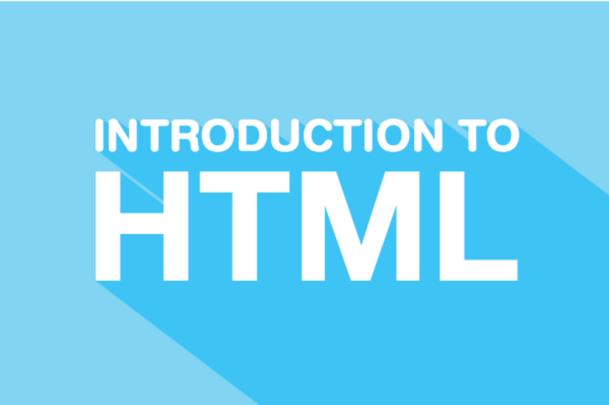
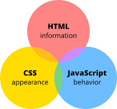

# Intro to HTML - Concepts

**Learning objective:** By the end of this lesson, students will be able to tktk

## What is HTML?

 

HTML is an acronym which stands for **HyperText Markup Language**. It is the standard markup language for documents designed to be displayed in a web browser by creating the structure of web content.

When a request is made by a web browser, it receives HTML documents from a web server and renders those documents into multimedia web pages.

HTML is one of the three main technologies used in creating web content in browsers, joined by **Cascading Style Sheets (CSS)** and **JavaScript (JS)**.

## Why use HTML?

In addition to HTML providing the structure of web content, it can also play a key role in **Search Engine Optimization (SEO)**. Depending on how documents are structured by utilizing the correct tags, HTML can improve their changec of showing up in requested searches, leading to imporoved visibility and success, from a marketing perspective

## HTML in Context

### The 3 fundamental client-side technologies of a web app:

As mentioned above, HTML works in conjuction with CSS and JavaScript. Below is additional information on these three technologies and a visual of how they work together.

##### HTML (Hypertext Markup Language)
- Purpose: Content and overall Structure of a web page
- Current Version: HTML5
- Standards Body: [World Wide Web Consortium (W3C)](https://www.w3.org/)

##### CSS (Cascading Style Sheets)
- Purpose: Styling & Layout of a web page
- Current Version: CSS3, with new "modules" still being added
- Standards Body: [CSS Working Group of the W3C](https://www.w3.org/Style/CSS/)

##### JavaScript (ECMAScript)
- Purpose: Behavior of a web page
- Current Versions: [Best shown here](https://en.wikipedia.org/wiki/ECMAScript) with [browser compliance status here](http://kangax.github.io/compat-table/es2016plus/)
- Standards Body: [ECMA International - TC39 Task Group](http://ecma-international.org/memento/tc39.htm)
