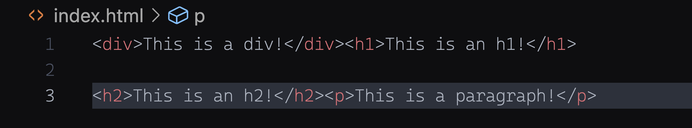
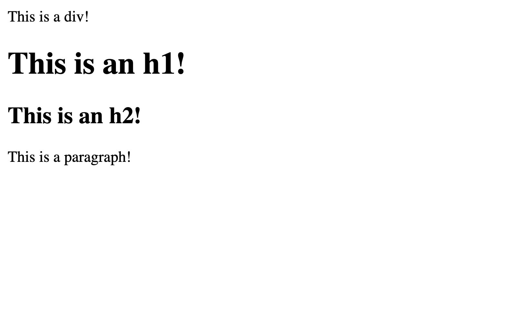
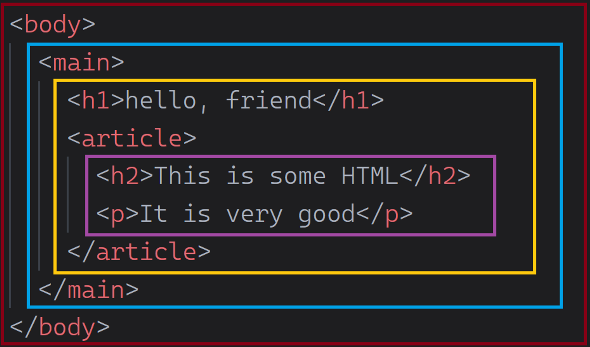

# Intro to HTML - Elements


**Learning objective:** By the end of this lesson, students will be able to tktk


## Tags

Most **Tags** have an opening and closing tag name inside angle brackets like this:

**Paragraph Tag:**
```html
<p></p>
```

**Div Tag (*div*ision or section, used as a container):**
```html
<div></div>
```

**Heading Tag (1 of 6):**
```html
<h1></h1>
```

Note the **slash** in the closing tag.

**Some tags** such as `` and `<br>` are called *empty tags* because they **never have content** and thus do not have a closing tag. Before HTML5, empty tags typically had a slash before the last angle bracket like this `<br/>`; however, since the introduction of HTML5, it is preferable to omit the slash.

**Line Break Tag:**
```html
<br>
```

**Image Tag:**
```html

```

## Elements

An **Element** consists of a *Tag* and its contents (if any), which may include other tags as well. For example:

**Paragraph Element with text:**
```html
<p>Have a great day!</p>
```

**Div Element with text:**
```html
<div>Introduction to HTML</div>
```

**Paragraph Element with text and <span> element:**
```html
<p>Have a <span>great</span> day!</p>
```
🧠 This is called nesting elements and don't worry, it's covered below. Just follow this [link](/elements/README.md#html-nesting)!

Some elements, such as a table cell `<td>`, would be pointless unless nested inside a `<tr>` row element.

**Like this:**
```html
<table>
  ...
  <tr>
    <td>HTML</td>
    <td>CSS</td>
    <td>JS</td>
  </tr>
</table>
```

**Never like this:**
```html
<div></div>
...
<td>HTML</td>
<td>CSS</td>
<td>JS</td>
...
<p></p>
```

> ‼️ Unlike JavaScript, our browsers will not complain if we make HTML or CSS mistakes. Instead, it just transparently does its best to correct our mistakes or fail. More about this in [HTML Quirks](../quirks/README.md#malformed-html)!

Most elements are defined as either *block* or *inline* elements.

- **Block** elements display on their own line and take up the full width available to them (they don’t allow other elements next to them unless they are styled to do so).
    
    Examples: `<div>`, `<h1>`, `<p>`

**Example of HTML in VSCode. Notice how on line 1, the <div> and <h1> are coded adjacent to one another. The same for the <h2> and <p> on line 3:**



**However, because they are block elements, they will render on their own line, taking up the full with available to them in the browser, as seen below:**



> ‼️ Block elements will not share the line they occupy, again, unless styled to do so!

    
- **Inline** elements are normally displayed without line breaks and occupy only enough space to contain their contents.
    
    Examples: `<span>`, `<td>`, ``

^^***Images of these?***

> 🧠 Inline elements generally cannot have their height and width set in CSS. However, using CSS like this, display: inline-block;, allows inline elements to be sized.
    

> ⚠️ Some inline elements (for example, the `` tag) are [replaced inline elements](https://developer.mozilla.org/en-US/docs/Web/CSS/Replaced_element) and can be given width and height without changing them into inline-block elements.

### Attributes

An element may contain **attributes** that provide additional information about that element. Attributes are placed within the opening tag and are typically *name/value* pairs separated by an equals sign (`=`).

The *value* should always be put in double-quotes (not single quotes). For example:

```html
<div class="my-class">My Content</div>
```
```html

```

Lowercase is used for both tags and attribute names.

The most common attribute is `class` for assigning CSS class(es) to an element.

The `id` attribute is used to target a specific element (or its contents) more easily for styling or JS access. The value of an `id` attribute should be unique in the document. The `id` attribute is optional and should be used *only when necessary* - the less we clutter our code, the better.

A few attributes, such as `required`, `checked`, `novalidate`, and `disabled`, stand alone without a value called *boolean attributes*.

^^***Images of these?***

You can add custom attributes of your own too! The HTML5 spec recommends that you prefix them with `data-`. Developers can use custom attributes to add additional information to the markup. They are commonly used by front-end frameworks such as AngularJS.

^^***Images of these?***

# HTML Nesting



When an element contains another element, the contained element is considered to be *nested* inside the outer element. The HTML graphic above has colored boxes drawn around elements to help visualize the relationship between parent and child elements.

You *must* indent nested elements. Properly indenting elements makes the markup more readable and **much** less prone to errors.


> 🧠 Properly indenting all code (HTML, CSS & JS) is mandatory if you want to get a job!


Describing Nested Relationships:

- **Descendant / Ancestor**: An element is considered a *descendant* if it is nested anywhere within its *ancestor*.
- **Child / Parent**: An element is considered a *child* if it is a direct descendant of its *parent*.
- **Siblings**: Two or more elements are considered *siblings* if they have the same *parent*.