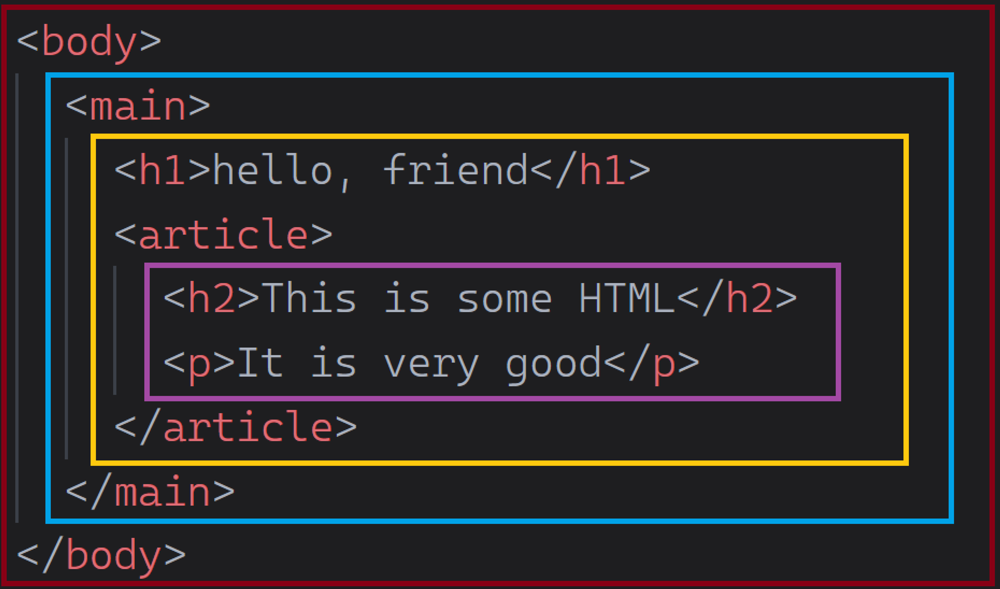
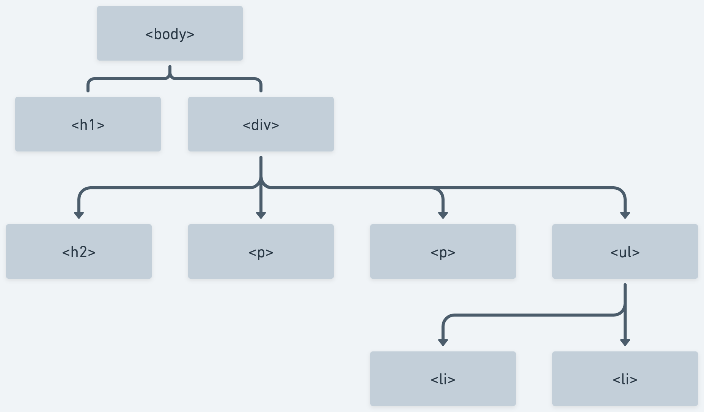

# Intro to HTML - Fundamentals


**Learning objective:** By the end of this lesson, students will understand some details about comments and creating elements in HTML.

## Comments

You can add comments to an HTML document using the following syntax:

```html
<!-- This is a comment -->
```

Comments can span multiple lines. Nothing inside the `<!--` and `-->` comment tag will not be rendered.

> 🧠 VS Code can automatically comment line(s) of code for us by pressing `⌘ Command` + `/`  in macOS or `Ctrl` + `/` in Linux and Windows.

## Element syntax

We'll talk more about the HTML boilerplate you created soon; for now add everything between the `<body>` and `</body>`. Content here will show up in the browser!

HTML documents are made up of elements.

At their simplest, elements are a pair of tags with content between them.

```html
<body>
  <h1>HTML Content!</h1>
</body>
```

tktk Hunter, can you turn the above syntax into a graphic with labels matching the below, similar to our other syntax assets?

1. The opening tag. The tag itself starts with a `<` and ends with a `>`. Tags must also include the element name, like `h1` above. This indicates the start of an element.
2. The content of an element, `HTML Content!` here.
3. The closing tag. The tag starts with a `</` (note the addition of the slash) and ends with a `>`. The closing tag also includes the element name between. It matches the element name of the opening tag.

These things combined create an element.

Most elements have a semantic meaning, and some default styling implemented by the browser. For example, an `<h1>` element indicates the main topic of a webpage. Along with this, its text content is bold, and its default font size is larger than any other text element.

Element names are always lowercase.

There are many different types of elements. MDN maintains a [full reference here](https://developer.mozilla.org/en-US/docs/Web/HTML/Element).

### Void elements

Some elements won't ever have text content. These are called void elements. Because they will not have text content, they do not have a closing tag. One such element is the `<hr>` element, which creates a horizontal rule.

```html
<hr>
```

You may see void elements written with a space and closing `/` added to the end of the tag. This is valid but not required.

```html
<hr />
```

## Element attributes 

Elements have attributes that contain details about the element.

The available attributes will vary from element to element. However, many attributes work across every element, like the `id` attribute. The `id` attribute is used to uniquely identify an HTML element when necessary. It can also be used to help style elements. Here's the syntax to apply an `id` to our existing `<h1>` element.

```html
<h1 id="title">HTML Content</h1>
```

tktk Hunter, can you turn the above syntax into a graphic with labels matching the below, similar to our other syntax assets?

1. A space between the element name and the attribute name.
2. The attribute name.
3. An equal sign.
4. An attribute value wrapped in opening and closing quotes.
   
A few additional notes about attributes:

- Working with attributes will only ever alter the first tag or the only tag in the case of a void element.
- Attribute names are always written in `lower-camel-case`. In this convention, each word is written in lowercase and separated by a dash `-`.
- Multiple attributes can be used on a single element. A space should separate attributes.
- By convention, spaces aren't used to separate the equal sign from the attribute name or value, even though it would still be valid. The convention exists because spaces are the only thing separating different attributes. Adding extra spaces can make your HTML less readable.
- Double quotes are often used around the attribute value in HTML, but single quotes are also valid.

Attributes add a layer of powerful complexity to our HTML. MDN maintains a [list of attributes here](https://developer.mozilla.org/en-US/docs/Web/HTML/Attributes).

### Element and attribute indentation

At times, attribute values could be lengthy, or you may have many of them. To make your code easier to read, you should split the opening tag as in the examples below. You don't need to write this code or pay attention to these attributes. Just observe how indentation and line breaks are handled :

```html
<div
  class="my-class"
  id="my-id"
  draggable="false"
  hidden="false"
>
  My Content
</div>
```

```html

```

In the course content, we will indent elements and tags in this way when an individual line of code is over 80 characters in length.

## Nesting elements

Elements can also be placed inside one another, like how we placed the `<h1>` element inside the `<body>` element above. This is called nesting.

```html
<body>
  <h1 id="title">HTML Content!</h1>
</body>
```

We can continue nesting elements inside of one another.

```html
<body>
  <h1 id="title">HTML Content!</h1>
  <div>
    <h2>The big idea</h2>
    <p>HTML lets us structure content!</p>
  </div>
</body>
```

Here, we've nested a `<div>` inside the `<body>`. `<div>` is a generic container element used to group content together. Inside of the `<div>`, there is an `<h2>` and a `<p>` element. The `<p>` element represents a paragraph of text.

You ***must*** indent nested elements. Properly indenting elements makes the markup far more readable and less prone to errors.

Some elements, like the list item `<li>` element, must be nested inside another element, like the unordered list `<ul>` element. For example:

```html
<body>
  <h1 id="title">HTML Content!</h1>
  <div>
    <h2>The big idea</h2>
    <p>HTML lets us structure content!</p>
    <p>Elements can:</p>
    <ul>
      <li>Have attributes</li>
      <li>Be nested in other elements</li>
    </ul>
  </div>
</body>
```

tktk, should this be kept?
> 🧠 Above, nested elements all have their own line, but this is not strictly required.
> Here's an example of a `<p>` element with text and a nested `<span>` element all on the same line:
> ```html
> <p>Have a <span>great</span> day!</p>
> ```

### Nested relationships


tktk Hunter, can you take the HTML from above and put it in a graphic like this?

When elements are nested, they form relationships with one another.

- **Descendant / Ancestor:** An element is a descendant if it is nested anywhere within its ancestor.
- **Child / Parent:** An element is a child if it is a direct descendant of its parent.
- **Siblings:** Two or more elements are siblings if they have the same parent.

Visualizing this with a family tree-like view may help. 


tktk Hunter, can you give this the Hunter treatment?

Just like in real life, a child can also be a parent (the `<ul>` element is a child of the `<div>` element and simultaneously the parent of the `<li>` elements). Again, proper indentation of your HTML helps keep these relationships clear and organized.

This is more than an analogy - this is the ideal way to think about how dom elements are connected because it even applies to how elements are shown to users in the browser.


tktk Hunter, starting with this as a base (or making your own base), can you take the highlighting from the nesting graphic at the top of this section and apply that to this?
